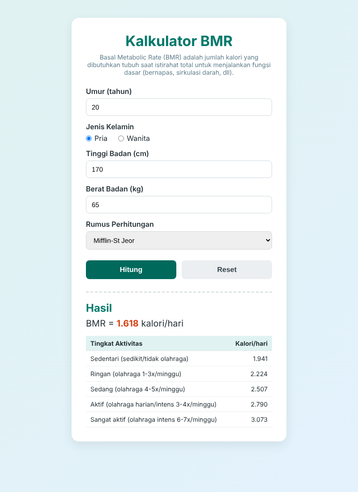

# Kalkulator BMR (Basal Metabolic Rate)

## Anggota Kelompok
| No | Nama | NIM |
|----|------|-----|
| 1 | Yardan Raditya Laksana | K3524017 |
| 2 | Galang Nur Seto |  |


## Deskripsi
Kalkulator BMR adalah aplikasi web sederhana (HTML, CSS, JavaScript) hasil pengembangan dari kalkulator BMI. Aplikasi ini menghitung **Basal Metabolic Rate**, yaitu jumlah kalori minimum yang dibutuhkan tubuh saat istirahat total untuk menjalankan fungsi dasar seperti bernapas dan sirkulasi darah. Referensi: [calculator.net/bmr-calculator](https://www.calculator.net/bmr-calculator.html).

### Fitur
- Input umur (15–80 tahun), jenis kelamin, tinggi badan (cm), dan berat badan (kg)
- Tiga pilihan rumus:
  - **Mifflin-St Jeor**
    - Pria: `10W + 6.25H − 5A + 5`
    - Wanita: `10W + 6.25H − 5A − 161`
  - **Revised Harris-Benedict**
    - Pria: `13.397W + 4.799H − 5.677A + 88.362`
    - Wanita: `9.247W + 3.098H − 4.330A + 447.593`
  - **Katch-McArdle**: `370 + 21.6(1 − F)W` (F = persentase lemak tubuh)
- Menampilkan kebutuhan kalori harian berdasarkan tingkat aktivitas (BMR × faktor aktivitas 1.2 – 1.9)
- Validasi input dan tombol reset

Keterangan: W = berat (kg), H = tinggi (cm), A = umur (tahun).

### Perubahan dari Kalkulator BMI
| Kalkulator BMI | Kalkulator BMR |
|----------------|----------------|
| Input: tinggi & berat | Input: umur, jenis kelamin, tinggi, berat (+ % lemak opsional) |
| Rumus: berat / tinggi² | Rumus: Mifflin-St Jeor, Harris-Benedict, Katch-McArdle |
| Output: nilai BMI & kategori | Output: BMR & kebutuhan kalori per tingkat aktivitas |

## Cara Menjalankan
1. Clone repository ini atau download sebagai ZIP.
2. Buka file `index.html` di browser.

## Struktur File
```
bmr-calculator/
├── index.html      # Struktur halaman & form input
├── style.css       # Tampilan aplikasi
├── script.js       # Logika perhitungan BMR
├── screenshot.png  # Screenshot aplikasi
└── README.md
```

## Screenshot

